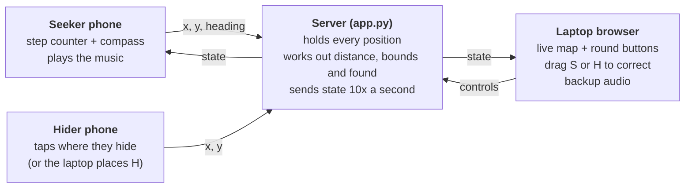

# Hot or Cold Engine: how the system works

9 November 2026 · Alejandro Santin

## Overview

A blindfolded seeker finds a hider by ear: the music on their headphones builds from a quiet pad into a full symphony as they get closer. The seeker's phone tracks their walking, a laptop server works out the distance, and everyone joins with one 4-character room code.

| Role | Device | What it does |
| --- | --- | --- |
| Laptop | Laptop browser (also runs the server) | Shows the room code, starts and pauses rounds, shows the live map, can drag either dot to correct it, and can play the audio as a backup |
| Seeker | Phone with headphones | Counts steps and reads the compass to work out its own position; plays all the music |
| Hider | Phone (optional) | Taps the map where they are hiding; if no hider phone is used, the laptop taps the map instead |

The seeker's screen shows only the distance in metres; the hider's screen shows the map.

## Architecture

Everything runs from one Python server on the laptop; every device is just a web page talking to it over Socket.IO.

The seeker's phone sends its position 10 times a second; the hider's phone sends one when tapped; the laptop sends round controls (start, pause, mark found, room size, dot corrections). The server sends the same state message back to every device in the room 10 times a second. When the laptop drags a dot, the server also tells that phone its corrected position.

| File | What's in it |
| --- | --- |
| `app.py` | The server: rooms, positions, distance, bounds, found, and sending the three web files |
| `index.html` | The layout of the home, laptop, seeker and hider screens |
| `style.css` | The look: dark theme, orange buttons |
| `script.js` | Everything the pages do: joining, step tracking, the map, and the music engine |
| `requirements.txt` | Python packages to install |

## Tracking: how the seeker's position is worked out

The seeker's phone uses pedestrian dead reckoning: every detected step moves the seeker 0.7 m in the direction the phone is facing. No cameras, beacons or extra hardware are involved.

1. **Enable walking sensors.** The phone asks for motion and compass permission (iPhone shows a prompt). If no motion data arrives within 2.5 s, an alert says so.
2. **Calibrate.** The seeker stands at the start spot (the middle of the play area) facing the top wall and taps the second button. That direction becomes "up" on the map, and the position resets to the room centre.
3. **Step detection.** The accelerometer's overall strength is compared with a slowly-updated estimate of gravity. A rise of more than 1.2 m/s² above gravity counts as a step, with steps at least 350 ms apart.
4. **Direction.** Each step uses the current compass heading minus the calibrated offset (iPhone: `webkitCompassHeading`; Android: absolute device orientation).
5. **Smoothing.** Each 0.7 m step is spread over 0.5 s, so the distance and the music change smoothly instead of jumping.
6. **Sending.** The phone sends its x, y and heading to the server 10 times a second, even when standing still, so the server knows the link is alive.

**Drift correction.** Step counting builds up error over a round (missed steps, compass wobble indoors). The laptop operator drags the S dot back to where the seeker really is; the server tells the seeker's phone the corrected position and it carries on from there.

**Laptop testing.** On a computer, the arrow keys or WASD walk the seeker at 1.2 m/s, so the system can be tested without walking.

## Server logic: distance, bounds and found

The server (`app.py`) is the single source of truth. Ten times a second it works out three things for each room and sends them to every device in it.

- **Distance:** a straight line between the seeker and hider positions, in metres. Until both exist it reports 8 m.
- **In bounds:** the seeker counts as out of bounds if they are more than 0.15 m outside the play area, or if their phone has sent nothing for 2.5 s.
- **Tracking OK:** true only when the seeker's phone is sending and the hider has been placed. Until then the round stays in standby and the laptop shows "- m".
- **Found:** during a running round, the seeker must stay within 0.5 m of the hider for 1.5 s. The laptop can also press Mark found.

Other rules:

- Rooms use 4-character codes (no 0, O, 1 or I, to avoid mix-ups). A laptop that refreshes gets the same code back.
- Only one seeker per room. A seeker who refreshes or briefly disconnects carries on from their last position.
- Positions are held within 1 m of the walls, so a drifting phone can't run off the map.
- Empty rooms are forgotten after 3 hours.
- The server only sends `index.html`, `style.css` and `script.js`; asking for anything else, such as `app.py`, gets "Not found".

## Music engine

All sound is made live in the seeker's browser with Tone.js, with no audio files. Four parts play together during a round: a target beacon, footstep notes, a backing track that builds into a symphony, and a boundary warning.

**Target beacon.** A short bell-like ping that plays the whole time the seeker is searching. It is pitched in the 1–4 kHz range, where hearing is most sensitive.

- **Pitch rises with proximity:** it climbs a pentatonic scale from C5 (6 m or more away) to E6 (on top of the hider).
- **Pulse speeds up:** one ping every 8 sixteenth-notes beyond 4 m, every 4 from 2.5 m, every 2 from 1 m, then every sixteenth-note.
- **Direction:** the ping is panned towards the side the hider is on, relative to the way the seeker's phone faces, and sounds duller when the hider is behind them.
- **Wrong way:** if the distance keeps growing (walking away at roughly 0.2 m/s or more), each ping gains a clashing note a semitone above. It turns consonant again once the seeker heads back.

**Footstep notes.** Every detected step plays a note from the current chord, up to two octaves higher as the seeker closes in, so the walker's movement adds to the music.

**Backing track.** A loop on Am – F – C – G that never stops; distance decides which layers join.

| Layer | Starts fading in at | Full volume by |
| --- | --- | --- |
| Pad | always on (half volume far away) | 2.5 m |
| Heartbeat kick, arpeggio | 4.2 m | 3.0 m |
| Bass line | 3.2 m | 2.0 m |
| Hi-hats | 3.0 m | 1.8 m |
| Clap | 2.2 m | 1.2 m |
| Chord plucks | 2.0 m | 1.0 m |
| Melody | 1.3 m | 0.6 m |
| Strings | 1.0 m | 0.4 m |

Closer also changes the backing track overall (measured over the last 6 m): a low-pass filter opens from about 700 Hz to about 11 kHz, reverb drops from 45% to 15%, and the tempo rises from 84 to 110 BPM.

Special states:

- **Waiting or not tracking:** only a quiet pad plays.
- **Out of bounds:** the beacon stops, the music ducks, and a dissonant cluster (C4, C#4, F#4) pulses every 0.7 s until the seeker steps back in.
- **Found:** a fanfare plays, then the full symphony: every layer plus timpani, a harmony line, sparkles and cymbal crashes at 118 BPM.
- **Signal lost:** if the seeker's phone hears nothing from the server for 2.5 s, the music goes silent.

The laptop's *Play audio here* button runs the same engine on the laptop as a backup (without footstep notes).

### Why the music works this way

Each musical choice answers a finding from the team's research or user testing.

| Finding | Source | How the music responds |
| --- | --- | --- |
| Rising pitch reads as "getting warmer"; the core mechanic maps distance to pitch height | Music research; idea development | Beacon pitch climbs a scale as distance shrinks |
| Constant rhythm made navigation easier | Craig, test 1 | Beacon pulses from the first second of a round, faster when closer |
| Low notes such as C2 were hard to hear; the ear is most sensitive at 1–4 kHz | Workshop tests 29/10; music research | Beacon sits at C5–E6 and skips the muffling filter; heartbeat kick raised from E1 to A1 |
| Pitch felt too linear; explore panning and timbre | Juan | Beacon is panned to the hider's side and dulled when the hider is behind |
| Distant targets sound wet and muffled, close ones dry and sharp; drones plus a separate target beacon | Papa Sangre | Backing track is muffled and reverberant far away, bright and dry close up; beacon is a distinct layer over it |
| Dissonance works as negative feedback, consonance as "on the right path" | Music research | Semitone clash when walking away; dissonant cluster at the boundary |
| Needed a distinct cue at the boundary edges | Shanay | Out-of-bounds cluster replaces the beacon |
| Wanted "more music with every step"; movement feedback from footsteps | Craig, test 1; Papa Sangre | Every step plays a chord tone, higher when closer |
| Movement should compose the music rather than a pre-written score | Idea development | Steps, beacon pitch and layers all come from the seeker's movement |
| Not musical enough; needs a musical journey | Xuan, workshop 29/10 | Layers build from a lone pad to a full symphony |
| Add a special reward sound when the hider is found | Juan | Fanfare plus the full symphony |

## Running a session

1. Put `app.py`, `index.html`, `style.css`, `script.js` and `requirements.txt` in one folder. Run `pip install -r requirements.txt` once.
2. Run `python app.py`. It prints an https address (port 1031 by default) and a QR code for phones.
3. On the laptop, open that address, accept the certificate warning and press **Laptop**. Note the room code.
4. On the seeker's phone, open the same address, accept the warning, press **Seeker**, type the code and press **Join**. Test tones confirm the sound works; then put the headphones on.
5. On the seeker's phone, press **Enable walking sensors**, then stand at the centre of the play area facing the top wall and press the calibrate button.
6. Place the hider: on the hider's phone (**Hider**, code, **Join**, then tap the map), or by tapping the laptop's map.
7. Press **Start round** on the laptop. Press it again for a new round after a find.

Network notes:

- **https is required.** Phones block the motion and compass sensors on plain http pages. The default `python app.py` serves https with a self-signed certificate, which is why each device shows a warning once.
- **Same network.** Every device must reach the laptop. University wifi (eduroam) often blocks devices from talking to each other; a phone hotspot avoids that. Alternatively, run `USE_HTTPS=0 python app.py` behind a Cloudflare tunnel (`cloudflared tunnel --url http://localhost:1031`), which gives a public https link that works over mobile data.
- **Internet needed.** Tone.js and Socket.IO load from a CDN when the page opens.

## Tuning and known limitations

The values most worth adjusting after a real walk-through:

| Setting | File | Default | What it changes |
| --- | --- | --- | --- |
| `stepLength` | script.js | 0.7 m | Distance moved per step; match it to the seeker's stride |
| `stepThresh` | script.js | 1.2 m/s² | Step sensitivity; raise it if steps are counted while standing still |
| `stepMinMs` | script.js | 350 ms | Shortest gap between two steps |
| `smoothing` | script.js | 0.35 | How quickly the seeker's distance and music follow changes |
| `LAYERS` | script.js | see Music engine | Distances where each instrument enters |
| `FOUND_RADIUS` / `FOUND_HOLD_S` | app.py | 0.5 m / 1.5 s | How close, and for how long, counts as found |
| `BOUNDS_MARGIN` | app.py | 0.15 m | Slack past a wall before the buzzer |
| `SEEKER_STALE_S` | app.py | 2.5 s | Silence from the seeker's phone before it counts as lost |
| `PORT` | app.py (environment variable) | 1031 | Port the server listens on |
| Play area size | Laptop screen | 6 m × 6 m | Width and depth of the room, set in the boxes under the map |

Known limitations:

- **Drift.** Dead reckoning gathers error with every step; the laptop operator has to nudge the S dot back during longer rounds.
- **Compass indoors.** Steel and electronics bend the compass reading, so the direction of each step can be wrong in some rooms.
- **Phone position.** Step detection assumes the phone is held or carried steadily; swinging it in a hand adds false steps.
- **One hider.** The system tracks a single hider per room.
- **Static hider.** The hider's position only changes when someone taps the map.
