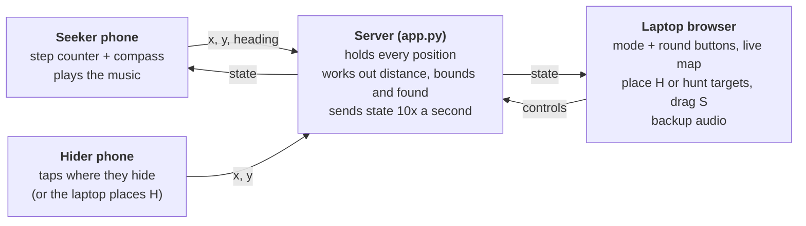

# Hot or Cold Engine V5: how the system works

13 November 2026 · Alejandro Santin

## Overview

A blindfolded seeker finds a hider by ear: the music on their headphones builds from a quiet pad into a full symphony as they get closer. The seeker's phone tracks their walking, a laptop server works out the distance, and everyone joins with one 4-character room code.

There are two game modes, picked on the laptop:

- **Hot or Cold:** one hider. Find them and the round ends with the full symphony.
- **Scavenger hunt:** the laptop drops up to 12 numbered targets on the map (no hider phones needed). The music guides the seeker to one target at a time; standing on it collects it, a chime plays, and the music turns towards the next one. Each find also unlocks a layer of the backing track for good, so the music grows over the whole hunt. Collect them all and the full symphony plays.

| Role | Device | What it does |
| --- | --- | --- |
| Laptop | Laptop browser (also runs the server) | Shows the room code, picks the mode, starts and pauses rounds, shows the live map, places the hider or hunt targets, can drag any dot to correct it, and can play the audio as a backup |
| Seeker | Phone with headphones | Counts steps and reads the compass to work out its own position; plays all the music |
| Hider | Phone (optional, Hot or Cold only) | Taps the map where they are hiding; if no hider phone is used, the laptop taps the map instead. In a scavenger hunt it just shows the map |

The seeker's screen shows only the distance in metres (and, in a hunt, how many targets are found); the hider's screen shows the map.

## Architecture

Everything runs from one Python server on the laptop; every device is just a web page talking to it over Socket.IO.

The seeker's phone sends its position 10 times a second; the hider's phone sends one when tapped; the laptop sends controls (mode, start, pause, mark found, room size, dot corrections, and adding, moving, scattering or removing hunt targets). The server sends the same state message back to every device in the room 10 times a second. When the laptop drags a dot, the server also tells that phone its corrected position.

| File | What's in it |
| --- | --- |
| `app.py` | The server: rooms, modes, positions, hunt targets, distance, bounds, found, and sending the three web files |
| `index.html` | The layout of the home, laptop, seeker and hider screens |
| `style.css` | The look: dark theme, orange buttons |
| `script.js` | Everything the pages do: joining, step tracking, the map, and the music engine |
| `requirements.txt` | Python packages to install |

## Tracking: how the seeker's position is worked out

The seeker's phone uses pedestrian dead reckoning: every detected step moves the seeker 0.7 m in the direction the phone is facing. No cameras, beacons or extra hardware are involved.

1. **Enable walking sensors.** The phone asks for motion and compass permission (iPhone shows a prompt). If no motion data arrives within 2.5 s, an alert says so.
2. **Calibrate.** The seeker stands at the start spot (the middle of the play area) facing the top wall and taps the second button. That direction becomes "up" on the map, and the position resets to the room centre.
3. **Step detection.** The accelerometer's overall strength is compared with a slowly-updated estimate of gravity. A rise of more than 1.2 m/s² above gravity counts as a step, with steps at least 350 ms apart.
4. **Direction.** Each step uses the current compass heading minus the calibrated offset (iPhone: `webkitCompassHeading`; Android: absolute device orientation).
5. **Smoothing.** Each 0.7 m step is spread over 0.5 s, so the distance and the music change smoothly instead of jumping.
6. **Sending.** The phone sends its x, y and heading to the server 10 times a second, even when standing still, so the server knows the link is alive.

**Drift correction.** Step counting builds up error over a round (missed steps, compass wobble indoors). The laptop operator drags the S dot back to where the seeker really is; the server tells the seeker's phone the corrected position and it carries on from there.

**Laptop testing.** On a computer, the arrow keys or WASD walk the seeker at 1.2 m/s, so the system can be tested without walking.

## Server logic: distance, bounds and found

The server (`app.py`) is the single source of truth. Ten times a second it works out three things for each room and sends them to every device in it.

- **Target:** where the music points. In Hot or Cold this is the hider. In a scavenger hunt it is one uncollected target: either the nearest one (default; another target has to be 0.5 m closer before it takes over, so the music doesn't flip-flop between two) or, with *Order: numbered*, the lowest-numbered one left.
- **Distance:** a straight line between the seeker and the target, in metres. Until both exist it reports 8 m.
- **In bounds:** the seeker counts as out of bounds if they are more than 0.15 m outside the play area, or if their phone has sent nothing for 2.5 s.
- **Tracking OK:** true only when the seeker's phone is sending and there is a target. Until then the round stays in standby and the laptop shows "- m".
- **Found:** during a running round, the seeker must stay within 0.5 m of the target for 1.5 s. In Hot or Cold that ends the round. In a hunt it collects that target and the next one takes over straight away; the round is found when every target is collected. The laptop's Mark found button does the same for the current target.

The state message also carries the mode, the list of hunt targets (each with a found flag), which one is active, and how many are found out of the total.

**Scavenger hunt setup (laptop):** tap empty map to add a target, drag a target to move it, right-click a target to remove it. *Scatter at random* replaces the targets with a fresh set spread at least 1.2 m apart, 0.5 m in from the walls and 1.5 m from the start spot. *Remove last* and *Clear all* do what they say. *Start round* un-collects every target, so the same layout can be replayed. Switching mode pauses the round.

Other rules:

- Rooms use 4-character codes (no 0, O, 1 or I, to avoid mix-ups). A laptop that refreshes gets the same code back.
- Only one seeker per room. A seeker who refreshes or briefly disconnects carries on from their last position.
- Positions are held within 1 m of the walls, so a drifting phone can't run off the map.
- Empty rooms are forgotten after 3 hours.
- The server only sends `index.html`, `style.css` and `script.js`; asking for anything else, such as `app.py`, gets "Not found".

## Music engine

All sound is made live in the seeker's browser with Tone.js, with no audio files. A backing track loops on Am – F – C – G and never stops; distance decides which instrument layers play and how loud.

| Layer | Starts fading in at | Full volume by |
| --- | --- | --- |
| Pad | always on (half volume far away) | 2.5 m |
| Heartbeat kick, arpeggio | 4.2 m | 3.0 m |
| Bass line | 3.2 m | 2.0 m |
| Hi-hats | 3.0 m | 1.8 m |
| Clap | 2.2 m | 1.2 m |
| Chord plucks | 2.0 m | 1.0 m |
| Melody | 1.3 m | 0.6 m |
| Strings | 1.0 m | 0.4 m |

Closer also changes the sound overall (measured over the last 6 m):

- **Brighter:** a low-pass filter opens from about 700 Hz far away to about 11 kHz on top of the hider.
- **Drier:** reverb drops from 45% to 15%.
- **Faster:** tempo rises from 84 to 110 BPM.

On top of the backing track:

- **Target beacon:** a short ping in the 1–4 kHz range, always on during a round. It rises in pitch and pings faster as the seeker closes in, is panned left or right towards the target, and sounds darker when the target is behind them.
- **Wrong way:** when the distance keeps growing, a semitone clash is added to the beacon; it goes back to a clean note once the seeker turns towards the target.
- **Footsteps:** every detected step plays a chord tone, up to two octaves higher when close.

Scavenger hunt extras:

- **Collect chime:** a quick rising arpeggio and a timpani hit, then one bell per target found so far, so the seeker can count their finds by ear.
- **Growing music:** each find unlocks the next layer (heartbeat, arpeggio, bass, hi-hats, clap, plucks) at a low level for the rest of the hunt, so the track builds up across the whole game even while the next target is still far away.
- When a target is collected the distance jumps straight to the next one rather than gliding, so it isn't mistaken for walking the wrong way.

Special states:

- **Waiting or not tracking:** only a quiet pad plays.
- **Out of bounds:** the music ducks and a dissonant buzzer (C4, C♯4, F♯4) sounds every 0.7 s until the seeker steps back in.
- **Found** (Hot or Cold hider, or the last hunt target): a fanfare plays, then the full symphony: every layer plus timpani, a harmony line, sparkles and cymbal crashes at 118 BPM.
- **Signal lost:** if the seeker's phone hears nothing from the server for 2.5 s, the music goes silent.

The laptop's *Play audio here* button runs the same engine on the laptop as a backup.

## Running a session

1. Put `app.py`, `index.html`, `style.css`, `script.js` and `requirements.txt` in one folder. Run `pip install -r requirements.txt` once.
2. Run `python app.py`. It prints an https address (port 1032 by default) and a QR code for phones.
3. On the laptop, open that address, accept the certificate warning and press **Laptop**. Note the room code.
4. On the seeker's phone, open the same address, accept the warning, press **Seeker**, type the code and press **Join**. Test tones confirm the sound works; then put the headphones on.
5. On the seeker's phone, press **Enable walking sensors**, then stand at the centre of the play area facing the top wall and press the calibrate button.
6. Pick the mode on the laptop.
   - **Hot or Cold:** place the hider on the hider's phone (**Hider**, code, **Join**, then tap the map), or by tapping the laptop's map.
   - **Scavenger hunt:** tap the laptop's map to drop targets, or press **Scatter at random**. Choose *nearest first* or *numbered* order.
7. Press **Start round** on the laptop. Press it again for a new round after a find (in a hunt, this replays the same targets).

Network notes:

- **https is required.** Phones block the motion and compass sensors on plain http pages. The default `python app.py` serves https with a self-signed certificate, which is why each device shows a warning once.
- **Same network.** Every device must reach the laptop. University wifi (eduroam) often blocks devices from talking to each other; a phone hotspot avoids that. Alternatively, run `USE_HTTPS=0 python app.py` behind a Cloudflare tunnel (`cloudflared tunnel --url http://localhost:1032`), which gives a public https link that works over mobile data.
- **Internet needed.** Tone.js and Socket.IO load from a CDN when the page opens.

## Tuning and known limitations

The values most worth adjusting after a real walk-through:

| Setting | File | Default | What it changes |
| --- | --- | --- | --- |
| `stepLength` | script.js | 0.7 m | Distance moved per step; match it to the seeker's stride |
| `stepThresh` | script.js | 1.2 m/s² | Step sensitivity; raise it if steps are counted while standing still |
| `stepMinMs` | script.js | 350 ms | Shortest gap between two steps |
| `smoothing` | script.js | 0.35 | How quickly the seeker's distance and music follow changes |
| `LAYERS` | script.js | see Music engine | Distances where each instrument enters |
| `FOUND_RADIUS` / `FOUND_HOLD_S` | app.py | 0.5 m / 1.5 s | How close, and for how long, counts as found (hider or hunt target) |
| `MAX_TARGETS` | app.py (and `maxTargets` in script.js) | 12 | Most hunt targets per room |
| `SWITCH_HYST` | app.py | 0.5 m | How much closer another hunt target must be before the music switches to it |
| `SCATTER_GAP` / `SCATTER_START_GAP` / `SCATTER_WALL` | app.py | 1.2 / 1.5 / 0.5 m | Spacing rules for *Scatter at random* |
| `HUNT_UNLOCK` / `HUNT_FLOOR` | script.js | 6 layers / 0.45 | Which layers each hunt find unlocks, and how loud they stay |
| `BOUNDS_MARGIN` | app.py | 0.15 m | Slack past a wall before the buzzer |
| `SEEKER_STALE_S` | app.py | 2.5 s | Silence from the seeker's phone before it counts as lost |
| `PORT` | app.py (environment variable) | 1032 | Port the server listens on |
| Play area size | Laptop screen | 6 m × 6 m | Width and depth of the room, set in the boxes under the map |

Known limitations:

- **Drift.** Dead reckoning gathers error with every step; the laptop operator has to nudge the S dot back during longer rounds.
- **Compass indoors.** Steel and electronics bend the compass reading, so the direction of each step can be wrong in some rooms.
- **Phone position.** Step detection assumes the phone is held or carried steadily; swinging it in a hand adds false steps.
- **One hider.** Hot or Cold tracks a single hider per room; use a scavenger hunt for several.
- **Target numbering.** Removing a hunt target renumbers the ones after it.
- **Static hider and targets.** Positions only change when someone taps or drags the map.
- **Many targets in a small room.** Scatter may place fewer than asked for if the spacing rules can't fit them all.
